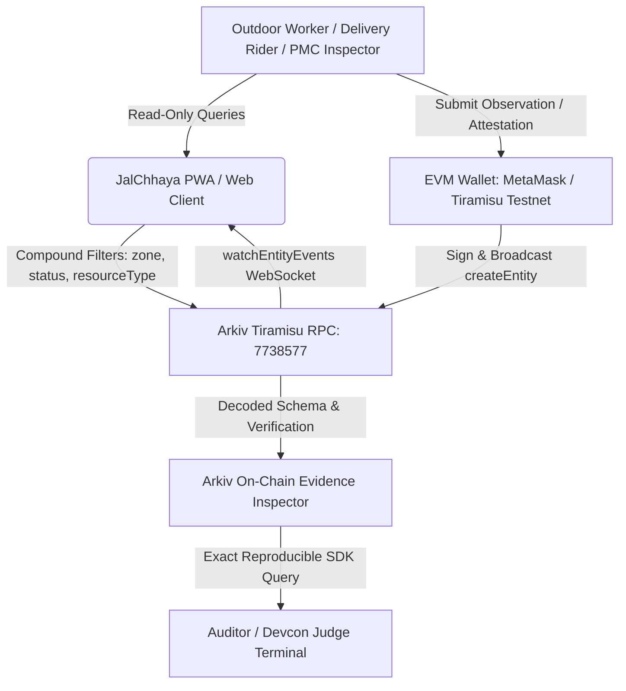

# JalChhaya Architecture Specification

**System**: JalChhaya (जलछाया) — Verifiable Extreme-Heat Relief Availability Network  
**Target City**: Pune, Maharashtra, India  
**Target Network**: Arkiv Tiramisu Testnet (`Chain ID: 7738577`)  
**Target Audience**: Outdoor workers, delivery riders (Swiggy, Zomato, Dunzo), auto/rickshaw drivers, street vendors, and municipal monitors.  
**Author**: Abhijeet Nardele  
**Date**: October 18, 2026  

---

## 1. System Vision & Problem Statement

Pune experiences severe summer heat spikes frequently exceeding 42°C, creating dangerous wet-bulb temperatures and heat exhaustion risks for over 200,000 outdoor gig workers and vendors. While the Pune Municipal Corporation (PMC) and private trusts maintain water kiosks (पाणपोई), shaded sheds, and cooling centers, workers face severe real-time uncertainty:
- **Dry/Broken dispensers**: A rider travels 2 km in 43°C heat only to find an unshaded or empty water tank.
- **Outdated Web2 registries**: Static municipality portals fail to reflect real-time queue depth, filter failures, or water temperature.
- **Censorship / Unaccountability**: Traditional centralized databases can quietly delete complaint records or hide municipal service outages.

**JalChhaya solves this through decentralized verifiable state on the Arkiv Network.** Every relief station, hourly availability observation, dispute attestation, and emergency heat outage is anchored directly to Arkiv Tiramisu with cryptographic provenance (`$creator`), structured typed attributes, and automated protocol-level expiry.

---

## 2. High-Level System Architecture



---

## 3. Four Core Arkiv Entity Contracts

All entities share common indexed attributes: `project_id = "jalchhaya-pune-2026"`, `city = "pune"`, and `zone`.

### 1. `relief_point` (Primary Facility Registry)
- **Purpose**: Canonical registry of physical water stations, cooling centers, and shaded pavilions in Pune.
- **Lifecycle**: Long-lived (e.g. 180 days).
- **Extension**: `permissionlessExtension: true`, allowing any civic contributor to pay gas to extend the facility's on-chain lifespan.
- **Attributes**: `project_id`, `entity_type`, `city`, `zone`, `geohash5`, `resource_type`, `accessibility`, `operator_class`.
- **Payload**: Multilingual names (`name`, `name_mr`, `name_hi`), landmark address hint, operating hours, amenities array.

### 2. `availability_observation` (Dynamic Field Reports)
- **Purpose**: Ephemeral, verifiable usability reports published by workers and civic scouts.
- **Lifecycle**: Short-lived (1–4 hours).
  - `status: "available"`: Expires in 2 hours (~3,600 blocks).
  - `status: "crowded"`: Expires in 1 hour (~1,800 blocks).
  - `status: "unavailable"`: Expires in 4 hours (~7,200 blocks) to signal service outage.
- **Attributes**: `project_id`, `entity_type`, `relief_point_key`, `zone`, `resource_type`, `status`, `severity` (1–5 numeric).
- **Payload**: Queue depth estimate, water temperature, non-personal field observation note.

### 3. `attestation` (Decentralized Verification & Dispute)
- **Purpose**: Independent confirmation or challenge of an existing observation.
- **Mechanism**: Attaches the verifier's immutable `$creator` address, targeting an observation key.
- **Attributes**: `project_id`, `entity_type`, `relief_point_key`, `observation_key`, `verdict` (`confirm` | `challenge`).
- **Trust Score**: Facilities with multiple independent `confirm` attestations display trusted verification badges; `challenge` attestations flag the observation for community re-inspection.

### 4. `incident` (Emergency Heat Outage Alerts)
- **Purpose**: Broadcasts critical heat-stress warnings, broken municipal pipelines, or microclimate heat spikes.
- **Lifecycle**: 12–24 hours with auto-pruning when the emergency condition resolves.
- **Attributes**: `project_id`, `entity_type`, `zone`, `severity`, `resolved` (0 | 1).

---

## 4. Query Architecture: 7 Compound SDK Patterns

JalChhaya executes all queries directly via `@arkiv-network/sdk`:

1. **Find all active Pune relief points**:
   ```typescript
   client.select().where({ project_id: str("jalchhaya-pune-2026"), entity_type: str("relief_point") }).limit(50);
   ```
2. **Filter by Pune municipal zone (e.g. Swargate)**:
   ```typescript
   client.select().where({ project_id: str("jalchhaya-pune-2026"), entity_type: str("relief_point"), zone: str("swargate") });
   ```
3. **Filter by resource type (Drinking Water)**:
   ```typescript
   client.select().where({ project_id: str("jalchhaya-pune-2026"), entity_type: str("relief_point"), resource_type: str("water") });
   ```
4. **Retrieve latest availability observations for a facility**:
   ```typescript
   client.select().where({ project_id: str("jalchhaya-pune-2026"), entity_type: str("availability_observation"), relief_point_key: key(pointKey) });
   ```
5. **Query high-severity outages**:
   ```typescript
   client.select().where({ project_id: str("jalchhaya-pune-2026"), entity_type: str("availability_observation"), status: str("unavailable") });
   ```
6. **Fetch independent verification attestations**:
   ```typescript
   client.select().where({ project_id: str("jalchhaya-pune-2026"), entity_type: str("attestation"), observation_key: key(obsKey) });
   ```
7. **Query active municipal heat emergency alerts**:
   ```typescript
   client.select().where({ project_id: str("jalchhaya-pune-2026"), entity_type: str("incident"), resolved: i32(0) });
   ```

---

## 5. Security & Privacy Boundary

- **No Personal Identifiable Information (PII)**: Worker names, phone numbers, vehicle registrations, and residential locations are strictly forbidden by Zod validation schemas.
- **Privacy-Minimizing Design**: Aligned with data-minimization principles of India's Digital Personal Data Protection (DPDP) Act, 2023 without claiming formal legal audit certification.
- **Safe Landmark Addressing**: Location hints reference well-known public transit nodes (e.g., "Behind Metro Gate 2", "Opposite Platform 3, Deccan Gymkhana").
- **Immutable Provenance**: The `$creator` attribute permanently ties each report to the signing wallet, disincentivizing spam through verifiable on-chain accountability.
- **Automatic Stale Data Eviction**: Thanks to Arkiv's native entity expiry, outdated reports expire automatically on-chain without requiring centralized garbage-collection cron jobs.

---

## 6. Accessibility & Localization

- **Trilingual Support**: Instant toggling between English, Marathi (मराठी), and Hindi (हिंदी).
- **Accessibility Verification**: Automated WCAG checks plus documented manual keyboard and screen-reader verification. Calibrated color tokens, visible focus rings, ARIA roles, live regions for WebSocket feeds, and touch targets >= 44x44px for field workers wearing riding gloves.
